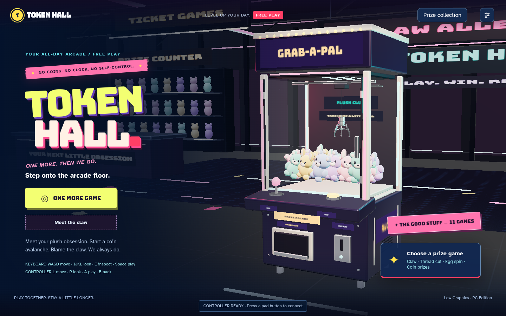
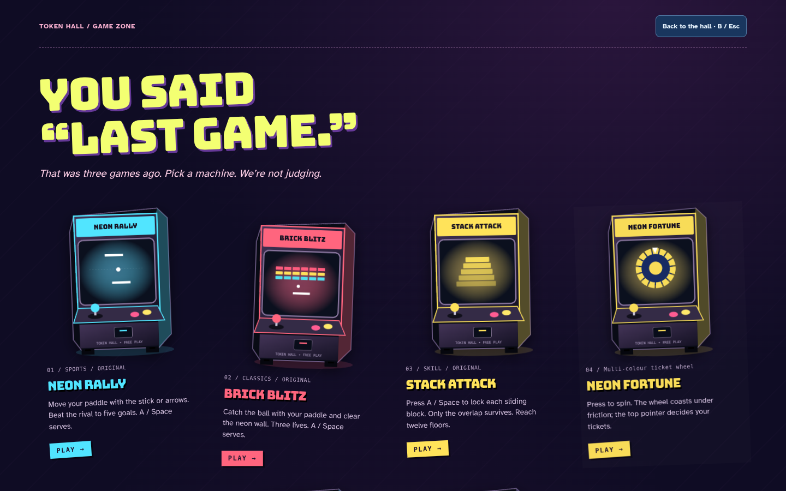

# TOKEN HALL — Just One More

A laptop-friendly arcade with bright cabinet marquees, electric blue lighting, ticket games, physics claws, and original arcade classics.



The room has a staggered cabinet lineup, taped flyers and scattered ticket scraps. The interface takes its cues from photocopied gig posters, prize stickers and worn arcade signage. All rewards are virtual; plays are free.

## Run it

Node.js 22 or later. No external runtime dependencies or account credentials are required.

```sh
npm ci
npm run dev
```

The local server listens on port 4173 (`PORT` overrides it). Open its local address in a WebGL2-capable desktop browser with hardware acceleration enabled.

```sh
npm test        # Controller, clock and complete machine-round checks
npm run build   # Syntax-check modules and create dist/
npm run preview # Serve dist/ on port 4173
```

Vercel is configured to build with `npm run build` and publish `dist`. Any static HTTPS host works. Do not use a file:// URL: browsers require an HTTP origin for ES modules. Gamepads require HTTPS or localhost, and some browsers expose a controller only after a button press.

## The games

- **Grab-a-Pal / Pillow Parade / Cosy Carnival / Figure Studio:** four prize collections for the physical claw. Aim across both X and Z axes, switch to the overhead view, then drop.
- **Snip & Win:** time the scissors to cut a swaying thread.
- **Egg Orbit:** spin for a surprise capsule.
- **Coin Cascade:** choose a lane and time the moving shelf.
- **Tower Tumble:** aim across the coin tower and change its balance.

## Controls

Standard Xbox, PlayStation and compatible controllers use the browser's standard Gamepad mapping. Controller prompts appear after connection. This release is tested with a virtual standard controller; physical device and browser combinations still need hands-on testing.

| Action                             | Controller                              | Keyboard / mouse                                       |
| ---------------------------------- | --------------------------------------- | ------------------------------------------------------ |
| Walk the hall                      | Left stick; L3 to run                   | WASD / arrows; Shift to run                            |
| Look in the hall                   | Right stick                             | Mouse / drag                                           |
| Inspect / play / drop / cut / spin | A / Cross                               | E to inspect; Space for game action; on-screen buttons |
| Aim claw / coin games              | Left stick or D-pad                     | Arrow keys for claw; WASD / arrows for coins           |
| Walk around claw                   | Right stick                             | WASD                                                   |
| Toggle claw camera                 | Y / Triangle                            | On-screen camera button                                |
| Retry after result                 | X / Square                              | On-screen retry button                                 |
| Choose another game                | Y / Triangle outside a game             | Choose a prize game button                             |
| Menu navigation                    | D-pad / left stick; A / Cross to select | Tab; Enter / Space                                     |
| Back / leave                       | B / Circle                              | Escape                                                 |
| Settings / pause                   | Start / Options                         | Settings button; Escape in hall                        |
| Prize collection                   | View / Share outside a menu             | Prize collection button                                |

The claw uses a radial 18% dead zone with rescaled analog travel, so small stick movements allow fine placement without drift. D-pad movement remains digital. Controls handle controllers in nonzero slots, disconnects and reconnections. A new controller must release its buttons before an action can fire, preventing accidental drops. A held action button fires once per press.

## Performance

Medium is the default preset: it retains bloom while avoiding the floor reflection render and ambient-occlusion passes. High and Ultra remain available in Settings. Low bypasses post-processing and shadows. Use `?quality=low` for slower devices and `?debug` for live render/physics counters.

Physics runs in fixed 1/120-second steps, with bounded catch-up work after stalls. Suspended time cannot build an unlimited physics backlog. Paused menus stop the main scene's render/physics work while controller menu navigation continues. Background cabinet updates are skipped during machine play. Static room decorations merge into the existing room batches. Fonts, physics and renderer dependencies are served locally; there are no external font or CDN requests.

These are workload reductions, not a measured frame-rate guarantee. Software-rendered cloud Chromium does not represent a desktop GPU.

## Browser playtest

Install Python Playwright and use an installed Chromium, or set `CHROMIUM_PATH` to its executable. With the dev server running:

```sh
python3 scripts/playtest.py
```

`TOKENHALL_URL` can select another served build. The test injects a virtual standard controller in slot 1, exercises menu navigation, hall movement, claw X/Z movement and camera switching, actions on all five machine types, pause, exit, and disconnect/reconnect behavior. Screenshots are written to the ignored `.playtest/` directory. Node tests additionally cover button edge detection, connection safety, radial dead zones, bounded simulation catch-up, and complete physical rounds plus retries for every machine type.

## Project provenance and layout

The supplied `TOKENHALL.rar` was an HTTrack mirror of the existing preview, not the original TypeScript/source repository. This project recovers its JavaScript application modules, repairs mirrored ES-module paths and removes HTML error pages masquerading as optional assets. The physics bundle includes its own WASM; the mirrored `.wasm.html` file was an error page and is not needed.

- `src/app.js`: recovered UI and application bootstrap.
- `src/arcade.js`: recovered 3D room, camera, input and machine views.
- `src/games.js`: recovered physics machines and prize definitions.
- `src/gamepad.js`: controller normalization, menu navigation and actions.
- `src/clock.js`: bounded fixed-step simulation clock.
- `src/base.css`, `src/after-hours.css`: original layout and new art direction.
- `assets/`: bundled renderer, physics, UI libraries, optional prize inspector and local fonts. Existing license notices are retained.
- `scripts/`: dependency-free build/server and browser playtest.

Recovered application modules retain some minified symbol names. This is not a restoration of the original authoring project or its dependency metadata. Keep vendor modules together: their exports are tied to this recovered build.

Collections stay in browser local storage. They are device/browser-local, not an online account. The existing desktop-first interface is retained; a connected controller can dismiss the small-screen PC notice, but touch-only gameplay is not implemented.

## The Midway expansion


Use **THE MIDWAY** button in the hall/title screen, or **RB / R1** on a controller outside a game. Eight additional photo-inspired cabinets live on a dedicated 2D physics floor:

| Cabinet        | Reference                 | Gameplay                                                  |
| -------------- | ------------------------- | --------------------------------------------------------- |
| Neon Fortune   | Multi-colour ticket wheel | Friction-driven wheel and pointer scoring                 |
| Big Night Spin | Big Spin wheel            | Long-coasting ticket wheel                                |
| Skyline Sprint | Superhero timing cabinet  | Stop a rising marker inside a moving target               |
| Magic Drop     | Magic Drop                | Aim balls through moving hoops, with physical rim bounces |
| Bowl-a-Ball    | Bowl-O-Ball               | Hold to charge, release to launch through the moving ring |
| Lucky Loop     | Free Lucky                | Stop a rotating key in the release window                 |
| Peg Riot       | Plinko                    | Gravity, peg collisions, restitution and scoring bins     |
| Skill Snip     | Skill Cut                 | Time scissors against a swaying cord to release a plush   |

These are original interpretations of the supplied photos, not verified replicas of commercial machine rules. Online research was blocked by the environment's web policy. The unidentified tiered drop machine was omitted as requested. The original 3D machines remain unchanged.

New floor controls: left stick / D-pad / arrows aim, A / Cross / Space acts (hold/release for bowling), X / Square starts a fresh round, B / Circle returns to the machine floor. Mouse/touch buttons are also available. Keyboard Tab is trapped inside the new floor. Tickets use the existing collection save path and are credited once per completed round. Closing a round before completion awards nothing.

The Midway uses fixed 240 Hz simulation steps, bounded catch-up, physical peg/rim collision response, and analytic exponential wheel drag. Background 3D rendering pauses while this floor is open. The expanded Node suite has 31 checks; `python3 scripts/midway-playtest.py` checks every new cabinet in Chromium with the local dev server running. Physical controller testing remains separate.

`python3 scripts/midway-controller-playtest.py` additionally checks controller-only entry/play/retry/exit and verifies that ticket awards persist exactly once.

## Arcade Club visual refresh and laptop classics

The current design uses acid yellow, hot pink and neon cyan, dark plum cabinet-glass surfaces, Bungee display typography, and locally hosted Atkinson Hyperlegible for controls and instructions. The game catalog includes original vector cabinets with marquees, screens, joysticks, buttons and coin slots. Timezone-style family arcades were the requested direction; direct access to Timezone’s official website was denied by the environment network policy, so this is an independent interpretation, not a researched reproduction or branded clone.

Three original games lead the Game Zone: **Neon Rally** (paddle rally against a tracking rival), **Brick Blitz** (40 destructible bricks and three lives), and **Stack Attack** (twelve precisely overlapping floors). All run locally with Canvas 2D, fixed-step physics, keyboard/controller controls and existing ticket saves. Rally and brick-breaker rounds time out after 90 seconds of active ball play; waiting to serve does not consume the match timer. The Game Zone now contains eleven cabinets in addition to the original 3D arcade.


